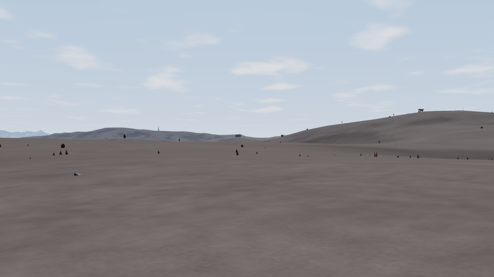
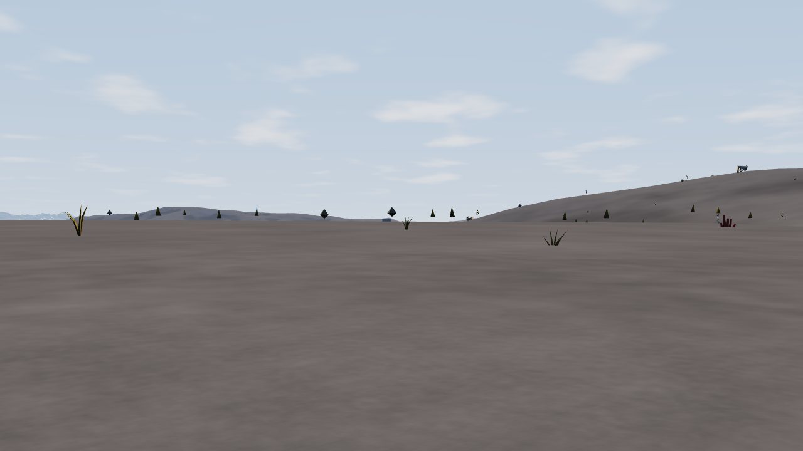
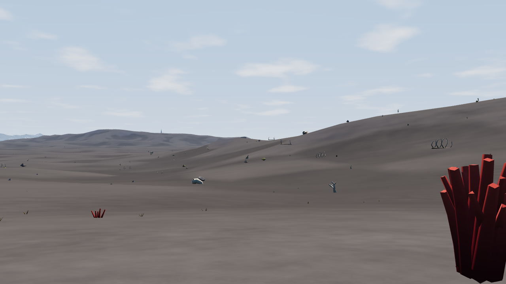

# FPS baseline: black downs, 400 m

Captured 2026-11-11 Europe/Zurich on master `51ecc67` (PR #7 included).
No terrain, scenery, materials or renderer behaviour was changed.

## Reproduce

```bash
TP_BROWSER_OFFLINE=1 npm run check:fps-baseline
```

Default output is ignored `shots/_tmp/fps-baseline/`, preserving this initial baseline.
Pass `-- shots/fps-baseline` only to deliberately replace the retained baseline.
The script uses local Vite and headless Chromium with the actual GPU. It completes the
full world bake, settles noon lighting, validates arrival on both traversals and checks
WebGL errors. `results.json` contains raw per-frame measurements, world SHA-256, Git
commit, GPU identity, settings, sampled ground and exact camera positions.

## Fixed route

- Fixture: `scripts/fps-route.json`; world `worlds/forgotten-shore.json`, seed 5150.
- Start `(40.83, 45.83)` km; finish `(40.83, 46.23)` km; camera faces south (+z), level pitch.
- Five walking views at 0/100/200/300/400 m. Approach is 400 m behind the start.
- 1.7 m above rendered terrain triangles, exaggeration 1, noon, tide 0, 1280 × 720.
- Normal GroundTravel speed 4 km/h with acceleration 60: effective 66.67 m/s.
- Actual walked surface distance about 401.1 m; both traversals arrived in about 6.1 seconds.
- All six sampled positions are dry black earth, slopes approximately 0.035–0.178.

The saved black-downs location was used as a candidate, then sampled and walked before
acceptance. This is a downs-only route; it does not reach a coral biome edge. The optional
coral-edge preference was deferred to keep a reproducible representative sparse-biome
baseline. The small undulation at 200 m and descending reveal at 400 m provide useful
comparison points without constructing a new composition.

## Measurements

Intel UHD Graphics (CML GT2), ANGLE/Vulkan. One cold and one immediately repeated warm
traversal; these are a baseline sample, not a statistical performance guarantee.

| Metric | Cold scenery cache | Warm replay |
|---|---:|---:|
| Initial path planning | 61.8 ms | 0.4 ms |
| Generated cells, including planning | 442 | 2 |
| RAF gap: median / p95 / worst | 16.7 / 16.7 / 116.6 ms | 16.7 / 16.8 / 16.8 ms |
| GPU draw: median / p95 / worst | 8.8 / 12.5 / 21.4 ms | 8.6 / 12.0 / 14.9 ms |
| Scenery update: median / p95 / worst | 2.5 / 6.8 / 35.6 ms | 1.7 / 3.8 / 5.8 ms |
| Median visible instances | 196 | 200 |
| Median draw calls | 50 | 50 |
| Total triangles, median | 236,813 | 237,007 |

| Fixed camera | Median GPU draw |
|---|---:|
| approach | 10.8 ms |
| walk-000m | 13.6 ms |
| walk-100m | 12.5 ms |
| walk-200m | 7.7 ms |
| walk-300m | 8.7 ms |
| walk-400m | 13.5 ms |

## Interpretation and limitations

- Cold planning blocks before the first measured RAF. Its 61.8 ms is reported separately;
  it is not included in the 116.6 ms worst RAF gap. Scenery update also exceeds its 4 ms
  generation allowance on some frames: that allowance is not a hard total-frame budget.
- Warm replay generated two extra cells due to slightly different frame-by-frame positions.
  It is a warm replay, not a claim of zero generation.
- Cold means cleared scenery cells, not a cold browser, shader cache or operating system.
- The controlled RAF loop calls the real GroundTravel update and render path, but bypasses
  the normal App.frame scheduler, UI work and campaign-clock advancement to hold noon/tide
  fixed. RAF numbers are controlled traversal measurements, not full-application FPS.
- GPU times use the existing disjoint-aware timer. Null samples are excluded. They measure
  GPU draw work and omit CPU generation, path planning and scheduling; do not add medians
  together or infer normal UI FPS from GPU times alone.
- Still captures settle streaming, discard four warmup draws and retain up to 12 GPU samples.
  Their cadence differs from traversal. No fixed FPS guarantee is established.
- A build ran during the final browser bake; it completed before traversal measurements.

## Visual observations

Reviewed approach and walking captures. Broad smooth ground occupies most of the frame;
small rocks and vegetation are isolated and scarcely frame a route or recognizable place.
The 200 m view has objects that appear to hover above the horizon/ground; this is a useful
ground-contact diagnostic, not proof of a particular geometry or placement bug. The 400 m
view reveals a shallow valley and a close red clump, but there is no composed destination.





## Validation and next task

`npm run build` passed (includes TypeScript checking). The real-browser baseline passed
both arrival assertions and returned GL error 0. No product code changed, so unrelated
terrain, layer-watcher and rendering regression suites were not rerun.

Next task: step 2 of `FPS_IMPROVEMENT_PLAN.md`, compose one convincing walk with simple
geometry. Retain this baseline and route for comparisons; do not implement step 2 as part
of baseline maintenance.
