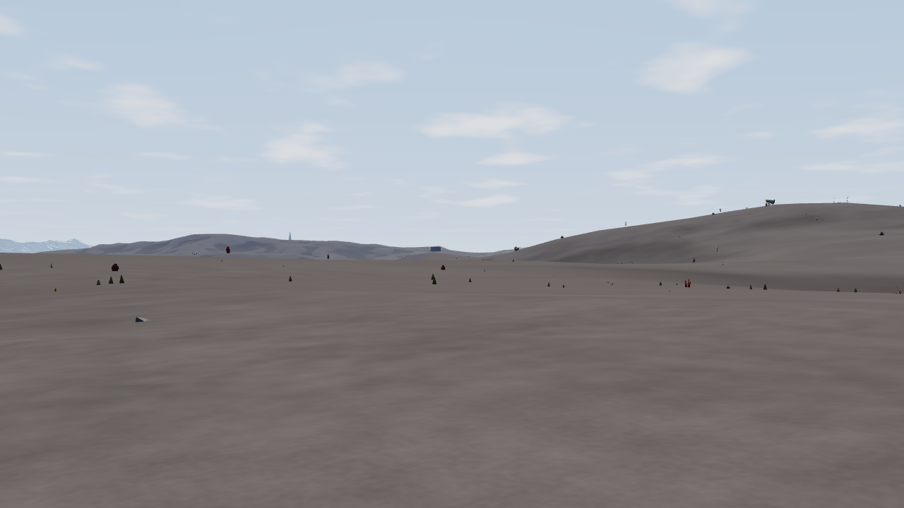
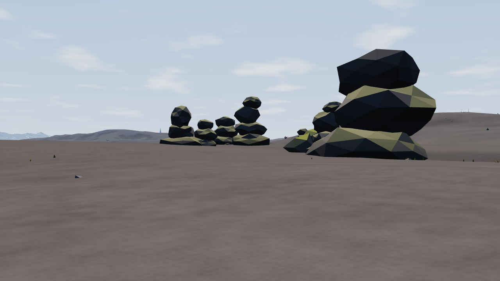
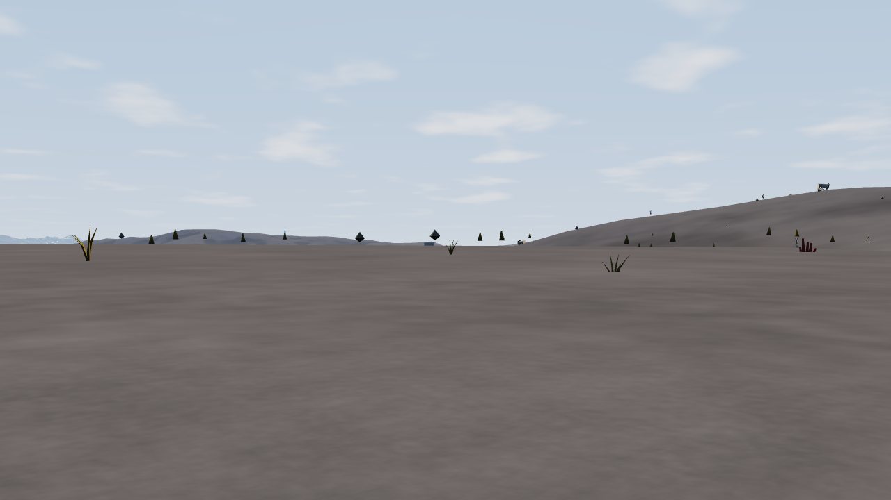
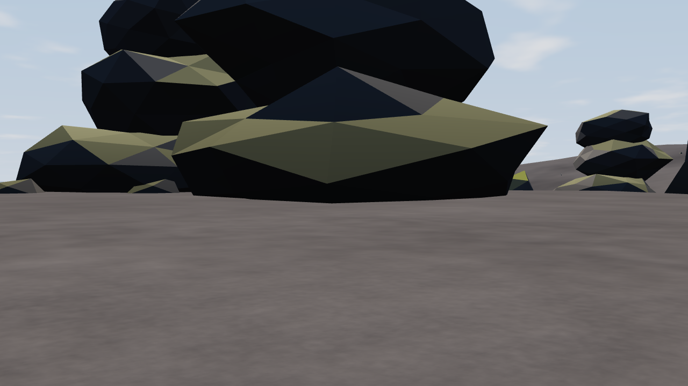
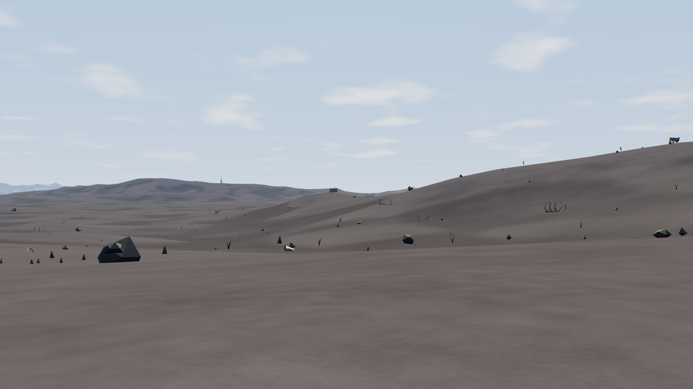
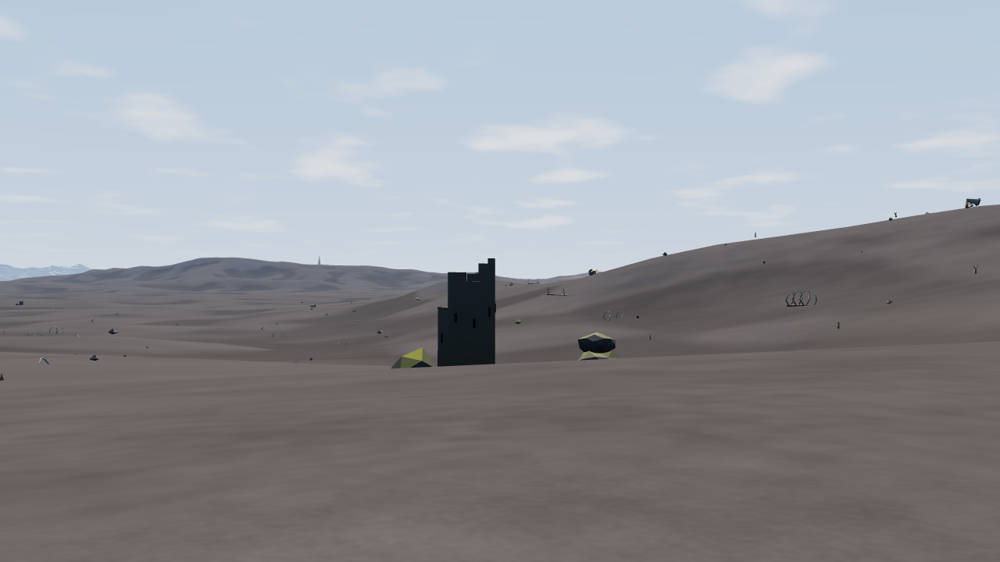
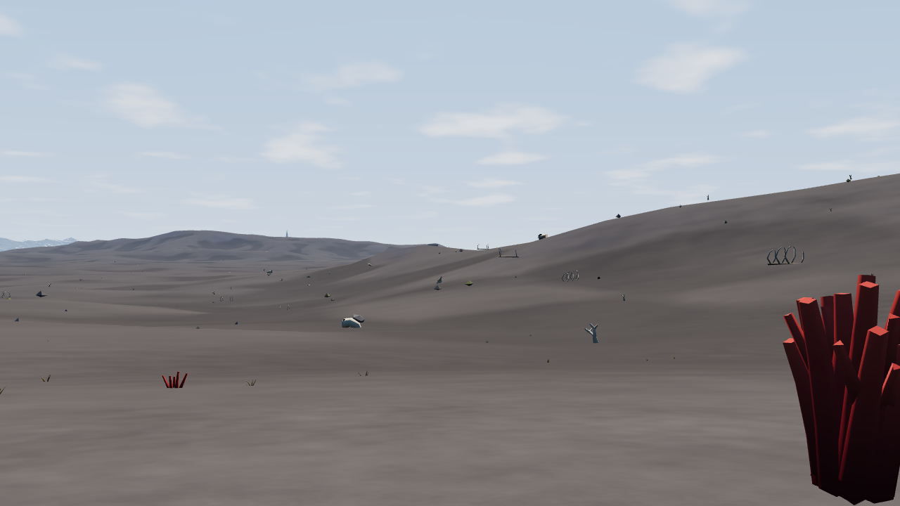
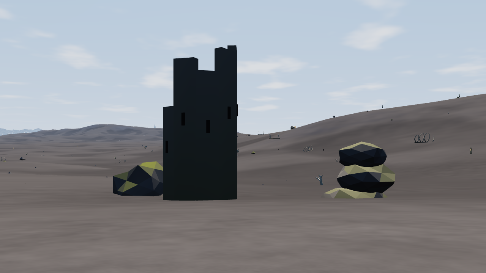
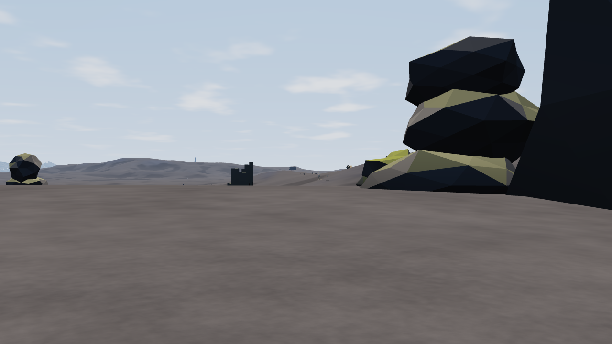

# Step 2: a composed downs walk

An opt-in, authored blockout on the existing 400 m baseline route. This is a spatial
layout experiment; it does not choose the final art style or generalize a generator.

## Try it

Run `npm run dev`, then open the server with:

`/?world=forgotten-shore&prototype=downs-walk`

After the bake it enters Player mode at the route start, looking south, at true scale
and noon. Drag to look and click ground to march. Head between the rock groups, take
the western (right-hand when facing south) passage around the central mass, then
continue toward the ruined tower. The original route ends about 63 m short of the tower.
The normal player clock advances while walking; the comparison harness freezes it.
Remove `prototype=downs-walk` to return to normal scenery. No world file is modified.

## Arrangement

- First 75 m: open ground, with a tall tor marking the approach.
- 105–200 m: asymmetric outcrop shoulders frame the route.
- About 235 m: a central rock mass conceals the lower ground and forces a bend;
  a western shoulder creates a passage rather than an isolated obstacle.
- Beyond 275 m: the space opens again and a ruined tower appears down the slope.
- The tower and two supporting masses sit beyond the 400 m finish, keeping a destination
  in view rather than placing the endpoint inside an object.

Sixteen authored objects use the existing tor, boulder and ruined-tower templates.
Existing scatter is suppressed only in a 170 m wide stage from 75–500 m along the
route. Elsewhere the ordinary source is unchanged. Authored objects are owned by
one streaming cell each and use the existing collision, instancing and LOD systems.
Support heights come from the actual rendered ground triangles, sampled across each
footprint; this avoids relying on a heightmap sample that differs from the walking mesh.
This is conservative seating, not the integrated local terrain/material work of step 3.

Implementation: `src/core/scenery/downsWalk.ts`; opt-in wiring in `src/main.ts` and
`src/app/app.ts`. The fixture is intentionally tied to the current Forgotten Shore.

## Reproduce and compare

```bash
TP_BROWSER_OFFLINE=1 npm run check:fps-baseline -- shots/_tmp/fps-composition --prototype
```

Retained output: `shots/fps-composition/`. Original baseline: `shots/fps-baseline/`.
The six original cameras are unchanged; two supplemental cameras show the western
passage and its exit. Results record the prototype flag and actual traversal positions.
Compare matching names at 1280×720, seed 5150, noon, tide 0 and exaggeration 1.
The measured route uses normal GroundTravel routing at 60× acceleration; it can bend
around the outcrop rather than following the original straight line.

| View | Baseline | Composition |
|---|---|---|
| Start |  |  |
| Before bend |  |  |
| Reveal |  |  |
| Finish |  |  |



## Visual assessment

The route now has a visible destination, foreground occlusion and a change in spatial
enclosure. The tower is concealed before the central mass and visible beyond it.
The existing tor kit still looks like stacked faceted stones; the dark tower is a simple
silhouette, and the ground remains smooth and bare. The painted reference's connected
banks, surface transitions and vegetation are not achieved by this blockout. These are
explicit reasons to review the arrangement before investing in step 3 or choosing style.

The distant approach also exposes existing LOD simplification: far tors become simple
blobs. This prototype does not change that system. The local geometry still casts no
new ground shadows. No claims of photorealism or a complete biome improvement.

## Validation

Build/typecheck, 72 existing unit tests and two new targeted isolation/routing tests
passed. The targeted tests prove that a direct line is blocked while a clear western
passage exists, and that unrelated cells retain their normal contents. Browser captures
check cold/warm arrival and WebGL health. Full timing evidence is in `results.json`.
The standard perf harness also completed with the prototype enabled (before the final
support-height and approach-size adjustment): saved views ranged 9.6–20.1 ms GPU,
zero idle draws and 30 drawn orbit frames/s. These are not route FPS guarantees.

Traversal timings below are controlled-loop measurements, not full UI FPS. As in the
baseline, the harness bypasses App.frame/UI and freezes the campaign clock. Cold cache
planning time is separate from RAF gaps. One cold and one warm run are not a statistical
performance guarantee. No unrelated terrain/layer edits were made.

| Final route metric | Cold | Warm |
|---|---:|---:|
| Planning (ms) | 77.2 | 12.8 |
| Walked distance (m) | 404.2 | 404.6 |
| RAF gap median / p95 / worst (ms) | 16.7 / 16.8 / 133.3 | 16.7 / 16.7 / 16.8 |
| GPU median / p95 / worst (ms) | 8.8 / 11.8 / 20.8 | 8.2 / 11.5 / 18.8 |
| Scenery update median / p95 / worst (ms) | 3.3 / 6.5 / 35.0 | 2.4 / 4.0 / 5.0 |

Both traversals arrived; WebGL error was zero. Captured from uncommitted step-2
changes on top of `51ecc67`; the results commit field identifies the base, not a
committed implementation. Cold generation/planning hitches remain a limitation.
