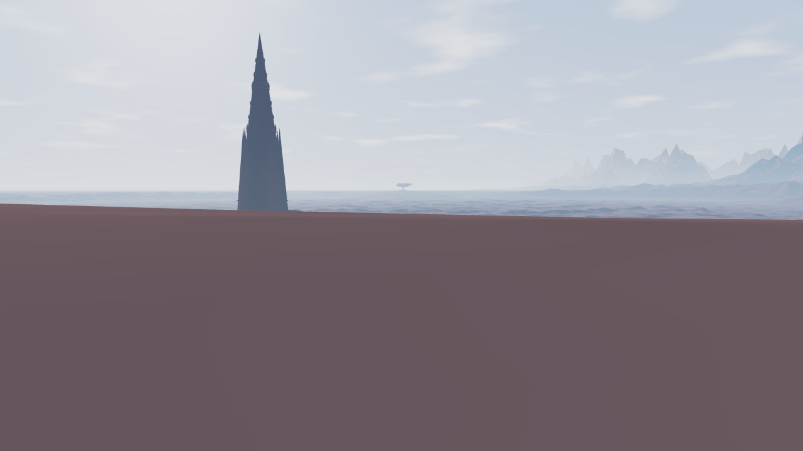
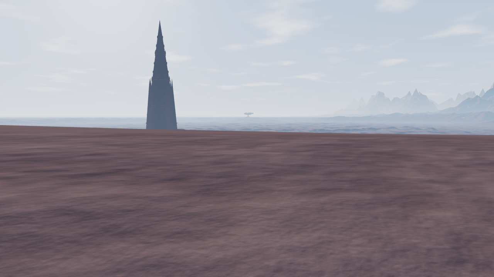
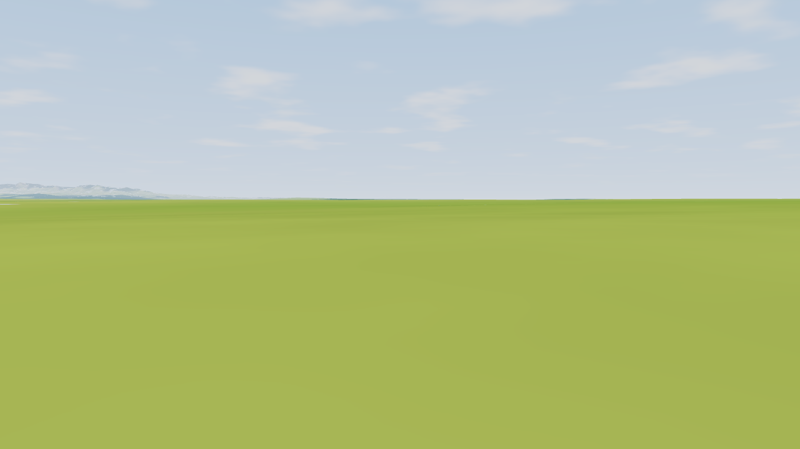
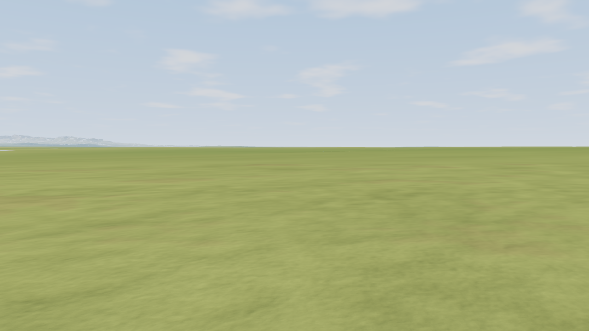
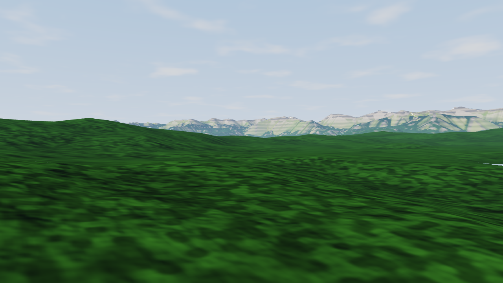
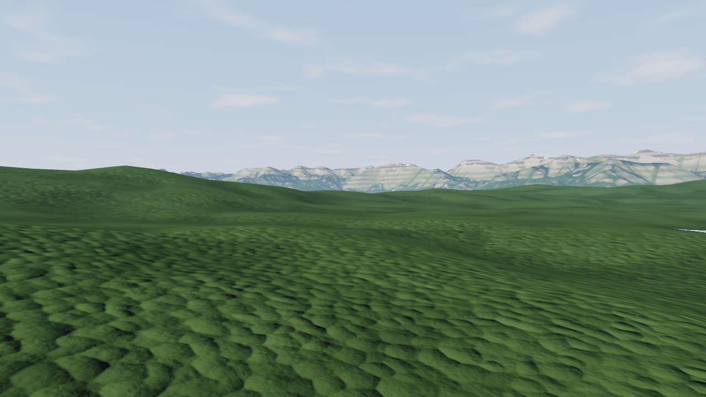
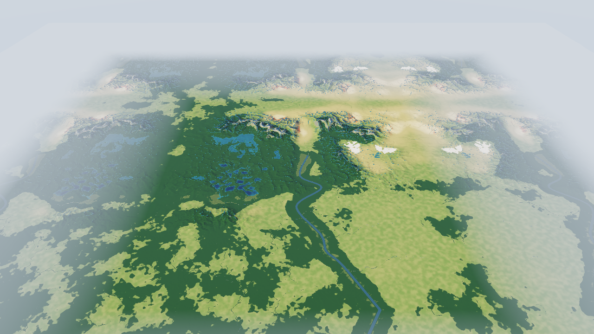
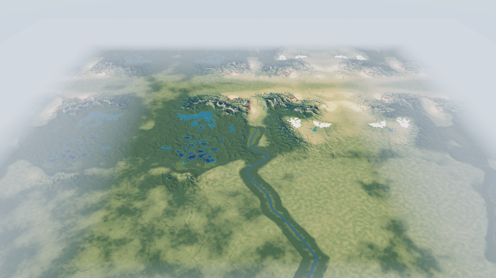

# Lowlands and forest material experiment

This changes surface rendering. Campaign geography and the terrain heightfield are
unchanged. All assets are generated locally; no texture downloads or AI image service
are used.

Fixed comparison views: 1280 × 720, true scale (exaggeration 1), identical world
files, camera coordinates, lighting and erosion settings. The ground views are two
metres above the terrain triangles. Forest view is 100 metres above the canopy
material's underlying terrain.

| View | Before | After |
|---|---|---|
| Forgotten Shore ground |  |  |
| Alpine plain at eye level |  |  |
| Alpine forest |  |  |
| Alpine overview |  |  |

## Changes

- Fine colour and normal detail at 6 m, 0.9 m and 0.12 m scales, fading before it
  becomes smaller than a pixel. The existing baked noise texture supplies it.
- A generated, tileable 512² canopy texture stores irregular crown slopes, height
  and colour variation. Directional lighting and darker joins give forests more
  surface structure. This adds about 1.33 MiB of texture memory including mipmaps.
- Broader forest transitions and muted vegetation colours reduce the sharp
  camouflage patches at regional scale.
- Surface detail fades from 1–3 km above the ground. The overview and map use a
  shader with those extra detail instructions compiled out. Water and terrain
  picking retain their existing geometry.

## Measured cost

Median GPU time on this notebook's Intel UHD (ANGLE/Vulkan), eight warmed samples
per view after discarding four warmups. These are GPU timings, not application FPS;
separate runs can also vary with GPU clock and temperature. Full raw results:
[before](shots/materials/timings-before.json),
[after](shots/materials/timings-after.json).

| Fixed comparison view | Before | After |
|---|---:|---:|
| Alpine ground | 6.2 ms | 7.5 ms |
| Alpine forest | 6.8 ms | 8.7 ms |
| Alpine overview | 13.9 ms | 16.5 ms |
| Coastal forest | 10.0 ms | 12.4 ms |
| Forgotten Shore ground | 7.6 ms | 11.2 ms |
| Forgotten Shore map | 11.3 ms | 11.4 ms |

The separate standard performance check, at the worlds' normal exaggeration and
saved views, measured Alpine Valley at 11.0–16.1 ms, Coastal Marches at 9.5–16.6 ms,
and Forgotten Shore at 5.4–20.0 ms GPU. Idle draws stayed at zero; automated orbit
drew about 41, 39 and 30 frames/s respectively. The improvement has a measurable
cost and does not establish a guaranteed 60 fps.

## Remaining limits

The plains and mineral ground have visible texture now, but the coarse terrain
still controls their shape. The forest is a shaded canopy surface: silhouettes
remain flat, crowns can still read as repeating cushions, and there are no trunks,
undergrowth, or walk-through trees. Marsh edges and river channels remain broad and
soft. The result is a material experiment, well short of the reference images'
vegetation volume and surface richness.

Reproduce with `TP_BROWSER_OFFLINE=1 npm run check:materials -- review`.
This captures 15 fixed views across Alpine Valley, Coastal Marches and Forgotten
Shore, checks repeatable rendering and WebGL/shader errors, and writes GPU timings
into `shots/_tmp/materials-review/`.
